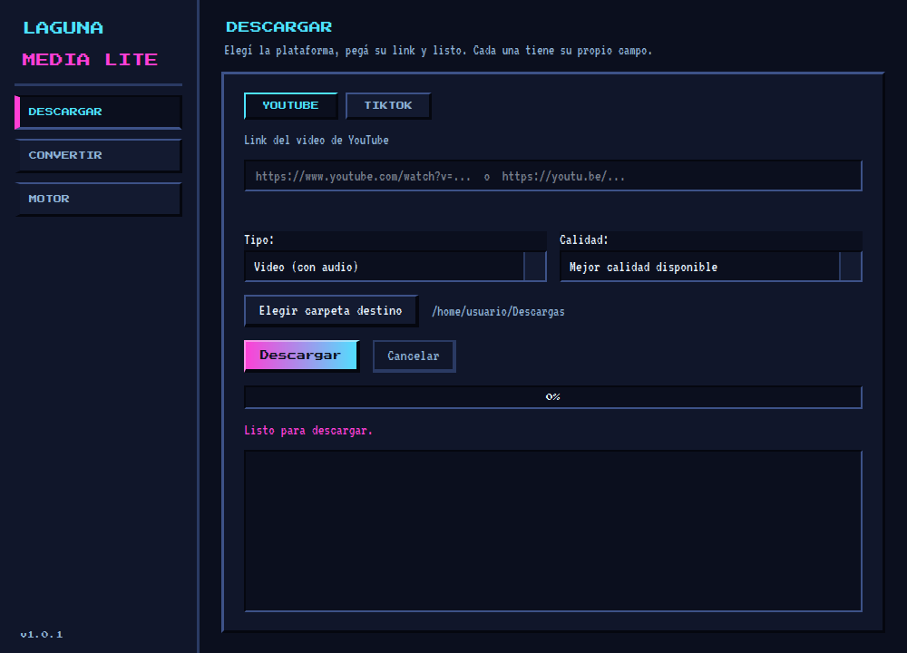
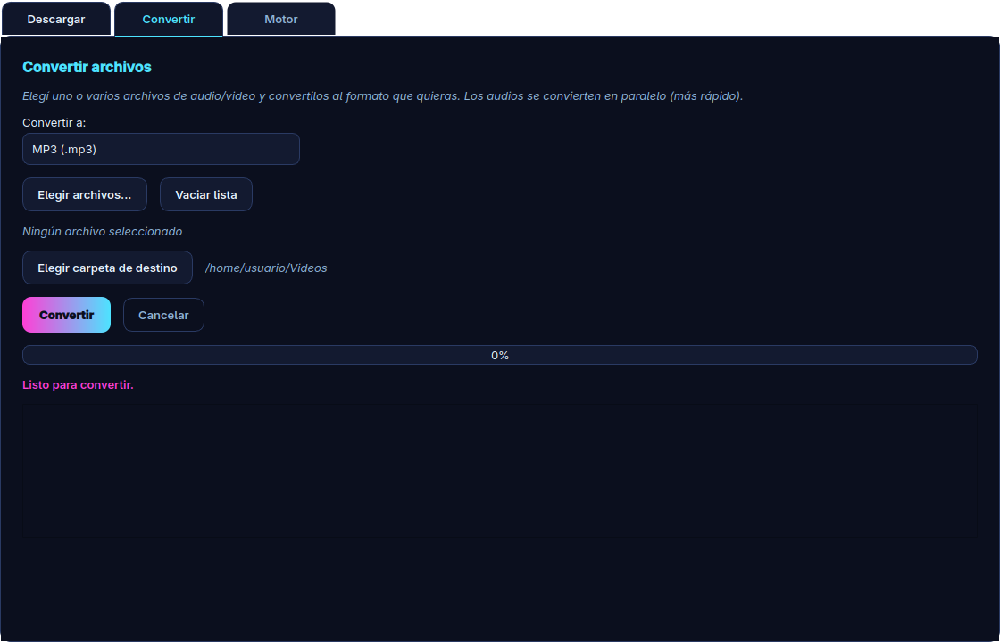
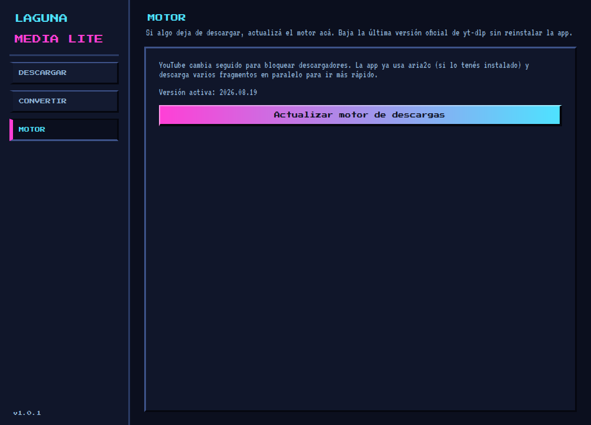

<p align="center">
  
</p>

<h1 align="center">Laguna Media Lite</h1>

<p align="center">
  <strong>Descargá de YouTube y TikTok, convertí audio y video. Nada más. Sin distracciones.</strong>
</p>

<p align="center">
  <a href="LICENSE"></a>
  
  
  
  
</p>

<p align="center">
  <a href="../../releases/latest"></a>
  <a href="CHANGELOG.md"></a>
</p>

---

Este repositorio distribuye **sólo los binarios compilados** de Laguna Media
Lite para **Linux** (Flatpak y AppImage) y **Windows** (portable). El código
fuente no se publica: es un proyecto propietario.

Lite es la variante mínima de **Laguna Media**: hace dos cosas —descargar de
YouTube/TikTok y convertir formatos— y las hace rápido, sin reproductores, sin
biblioteca, sin temas y sin configuración.

---

## Tabla de contenido

- [Qué es Laguna Media Lite](#qué-es-laguna-media-lite)
- [Capturas de pantalla](#capturas-de-pantalla)
- [Descargas](#descargas)
- [Instalación](#instalación)
- [Primeros pasos](#primeros-pasos)
- [Qué hace](#qué-hace)
- [Requisitos](#requisitos)
- [Cómo está construida](#cómo-está-construida)
- [Solución de problemas](#solución-de-problemas)
- [Preguntas frecuentes](#preguntas-frecuentes)
- [Privacidad](#privacidad)
- [Calidad y verificación](#calidad-y-verificación)
- [Historial de cambios](#historial-de-cambios)
- [Proyecto relacionado](#proyecto-relacionado)
- [Licencia](#licencia)
- [Autor](#autor)
- [Aviso legal](#aviso-legal)

---

## Qué es Laguna Media Lite

| | Laguna Media | Laguna Media Lite |
|---|---|---|
| Descargar YouTube / TikTok | ✅ | ✅ |
| Convertir audio y video | ✅ | ✅ |
| Reproductor de música y video | ✅ | ❌ |
| Conversión de códec (H.264/HEVC/AV1) | ✅ | ❌ |
| Biblioteca con miniaturas y caché | ✅ | ❌ |
| Temas y personalización | ✅ | ❌ (tema fijo) |
| Secciones | 7 (pestañas) | **3 (barra lateral)** |
| Arranque | ~3 s | **casi instantáneo** |
| AppImage para Linux | 163 MB | **153 MB** |
| Flatpak para Linux | — | **107 MB** |
| Portable para Windows | 112 MB | **102 MB** |

Si además querés reproductor, biblioteca, temas y versión Android, usá la app
completa: **[Laguna Media](https://github.com/JonathanDevHurtado/LagunaMedia-App)**.

---

## Capturas de pantalla

| Descargar | Convertir |
|---|---|
|  |  |

<p align="center">
  
</p>

*Capturas de la aplicación real, con rutas de ejemplo.*

---

## Descargas

Todos los binarios de la última versión están en
**[Releases → última versión](../../releases/latest)**.

| Archivo | Plataforma | Requisitos |
|---|---|---|
| [`LagunaMediaLite-x86_64.flatpak`](../../releases/latest/download/LagunaMediaLite-x86_64.flatpak) | Linux x86_64 | Flatpak 1.10+ (Fedora, Ubuntu, Debian, Arch…) |
| [`LagunaMediaLite-x86_64.AppImage`](../../releases/latest/download/LagunaMediaLite-x86_64.AppImage) | Linux x86_64 | glibc 2.35+ (Fedora 36+, Ubuntu 22.04+, Debian 12+) y `libfuse2` |
| [`LagunaMediaLite-portable-win64.zip`](../../releases/latest/download/LagunaMediaLite-portable-win64.zip) | Windows 10 / 11 x64 | Ninguno (portable, sin instalador) |
| [`SHA256SUMS.txt`](../../releases/latest/download/SHA256SUMS.txt) | — | Huellas SHA-256 para verificar la descarga |

### Verificar la descarga (recomendado)

**Linux:**

```bash
sha256sum -c SHA256SUMS.txt
```

**Windows (PowerShell):**

```powershell
Get-FileHash .\LagunaMediaLite-portable-win64.zip -Algorithm SHA256
# Comparar el resultado con la línea correspondiente de SHA256SUMS.txt
```

---

## Instalación

### Linux — Flatpak (recomendado)

Funciona en cualquier distribución moderna, incluidas **Fedora 41+** y
**Ubuntu 24.04+**, donde el AppImage ya no abre porque no traen `libfuse2`.

```bash
flatpak install --user LagunaMediaLite-x86_64.flatpak
flatpak run com.lagunamedia.LagunaMediaLite
```

La primera vez, Flatpak descarga solo el runtime `org.freedesktop.Platform//24.08`
si no lo tenés instalado. La app queda en el menú de aplicaciones.

### Linux — AppImage

No hace falta instalar nada:

```bash
chmod +x LagunaMediaLite-x86_64.AppImage
./LagunaMediaLite-x86_64.AppImage
```

Si el sistema no tiene FUSE habilitado:

```bash
./LagunaMediaLite-x86_64.AppImage --appimage-extract-and-run
```

### Windows — portable

1. Descomprimí `LagunaMediaLite-portable-win64.zip` en cualquier carpeta.
2. Ejecutá `lagunamedialite.exe`.

No hay instalador, no toca el registro y no necesita permisos de
administrador. Para moverla, movés la carpeta completa.

---

## Primeros pasos

1. **Elegí dónde guardar.** La primera vez usa tu carpeta de Descargas; podés
   cambiarla desde la sección *Descargar*.
2. **Descargá algo.** Elegí **YouTube** o **TikTok**, pegá el link en el campo
   de esa plataforma y tocá **Descargar**. Podés bajar el video completo (hasta
   4K si el video lo ofrece) o sólo el audio.
3. **Convertí si hace falta.** En *Convertir* elegís uno o varios archivos y el
   formato de salida (MP3, Opus, M4A, FLAC, WAV, OGG, MP4 o MKV).
4. **Si algo no descarga, actualizá el motor.** En la sección *Motor* hay un
   botón que baja la última versión oficial de yt-dlp sin reinstalar la app.
   Es la solución al 90% de los *"YouTube ya no descarga"*.

---

## Qué hace

### Descargar

- **YouTube y TikTok separados**: elegís la plataforma y cada una tiene su
  propio campo de link, con validación por dominio. No hay que adivinar de
  dónde viene la URL.
- **Video con audio** hasta 4K/2160p, según lo que ofrezca el video.
- **Sólo audio** en MP3, Opus, M4A, FLAC o WAV, con bitrate seleccionable.
- **8 fragmentos en paralelo** (`concurrent_fragment_downloads`) y uso
  automático de **aria2c** si está instalado.
- Progreso real: velocidad, tiempo restante y tamaño, leídos del propio
  descargador (no una barra inventada).

### Convertir

- Formatos de audio: **MP3, Opus, M4A, FLAC, WAV, OGG**.
- Formatos de video: **MP4 (H.264), MKV (H.264)**.
- Conversión **en paralelo**: varios archivos a la vez según los núcleos de la
  CPU, con progreso individual por archivo.
- `-c:a copy` cuando el formato lo permite: no recomprime el audio si no hace
  falta, así no se pierde calidad ni tiempo.

### Motor

- Actualiza **yt-dlp** a la última versión oficial con un clic.
- La descarga el zipapp oficial desde GitHub Releases y lo deja en
  `~/.local/share/lagunamedia/ytdlp`, con prioridad sobre el incluido en el
  binario. No hace falta publicar una versión nueva de la app.
- La app **no** se conecta a internet al arrancar: sólo cuando descargás algo
  o cuando pedís actualizar el motor.

---

## Requisitos

| Plataforma | Requisitos |
|---|---|
| **Linux (Flatpak)** | Flatpak 1.10 o superior. Cualquier distribución x86_64. |
| **Linux (AppImage)** | x86_64, glibc 2.35+ (Fedora 36+, Ubuntu 22.04+, Debian 12+) y `libfuse2`. |
| **Windows** | Windows 10 u 11 de 64 bits. Sin instalación. |

No hace falta instalar Python, FFmpeg ni yt-dlp: van incluidos en el binario.

---

## Cómo está construida

Lite no es una versión "capada" de la app completa: es un proyecto aparte que
comparte el mismo motor y el mismo contrato de nombres, pero no importa nada de
la app grande.

| Pieza | Tecnología |
|---|---|
| Interfaz | Python 3 + PySide6 (Qt Widgets) |
| Tema | QSS generado, estética de bloques con tipografías pixeladas (OFL) |
| Descarga | yt-dlp (Unlicense) |
| Conversión | FFmpeg estático (GPL) |
| Configuración | QSettings en `~/.config/LagunaMediaLite/` |
| Empaquetado | PyInstaller (onedir) → AppImage / Flatpak / ZIP portable |

**Por qué es liviana.** El archivo de PyInstaller excluye QtMultimedia y todo
el código de reproducción, biblioteca y miniaturas: son decenas de MB y
segundos de arranque que Lite no necesita.

**Por qué un proyecto separado y no un "modo simple".** Porque cargar el
reproductor, la biblioteca y las miniaturas cuesta tiempo y memoria aunque no
se usen. Un proyecto chico es más rápido y más simple de mantener.

**Por qué el motor se actualiza en caliente.** YouTube cambia sus defensas cada
pocas semanas. Con el actualizador, un cambio no obliga a esperar una versión
nueva de la app.

**Empaquetado.** Linux: PyInstaller `onedir` → AppDir → AppImage, compilado en
un contenedor Ubuntu 22.04 para que corra en cualquier distribución con glibc
2.35+. Windows: PyInstaller `onedir` → ZIP portable. Flatpak: manifiesto propio
con `org.freedesktop.Platform//24.08`, PySide6-Essentials y yt-dlp dentro del
sandbox y FFmpeg como binario estático.

---

## Solución de problemas

### Los tres casos más comunes

**1. El AppImage no abre en Fedora 41+ / Ubuntu 24.04+**

Esas distribuciones ya no incluyen `libfuse2`, que el AppImage necesita para
montarse. Dos salidas:

- Usá la versión **Flatpak** (recomendado), o
- ejecutá el AppImage sin FUSE:

  ```bash
  ./LagunaMediaLite-x86_64.AppImage --appimage-extract-and-run
  ```

**2. "YouTube ya no descarga" / error `unable to extract`**

YouTube cambió algo y el motor incluido quedó viejo. Andá a **Motor →
Actualizar motor de descargas**. Se baja la última versión oficial de yt-dlp y
la descarga vuelve a funcionar sin reinstalar la app.

**3. El link es rechazado**

El campo valida contra la plataforma elegida. Si pegaste un link de TikTok con
**YouTube** seleccionado, el mensaje lo dice: cambiá de plataforma o revisá la
URL. En TikTok, algunos videos viejos o restringidos por región devuelven
*"IP address is blocked from accessing this post"*: eso lo decide TikTok, no la
app; probá con otro video u otra red.

### Tabla rápida

| Síntoma | Causa | Solución |
|---|---|---|
| El AppImage no abre y no muestra nada | Falta `libfuse2` | Flatpak, o `--appimage-extract-and-run` |
| El AppImage muestra `GLIBC_2.xx not found` | Sistema más viejo que glibc 2.35 | Actualizá la distro o usá Flatpak |
| "YouTube no descarga" / `unable to extract` | Motor (yt-dlp) viejo | **Motor → Actualizar motor** |
| "Ese link no es de YouTube/TikTok" | Plataforma equivocada o URL incompleta | Cambiá la plataforma o copiá el link del video |
| TikTok: `IP address is blocked` | TikTok bloquea ese post por región o antigüedad | Probá con otro video u otra conexión |
| La descarga baja sin audio o sin video | El formato elegido no existe para ese video | Elegí *Mejor calidad disponible* o bajá el audio por separado |
| Descargas lentas | Una sola conexión | Instalá `aria2c` (`sudo dnf install aria2` / `sudo apt install aria2`) |
| Windows marca el `.exe` como desconocido | Binario sin firma comercial | Verificá el SHA-256 y ejecutá igual |
| El Flatpak no aparece en el menú | Instalación sólo para el usuario | `flatpak run com.lagunamedia.LagunaMediaLite` |
| La configuración no se guarda | Permisos de la carpeta de configuración | Revisá `~/.config/LagunaMediaLite/` |

---

## Preguntas frecuentes

**¿Es legal descargar de YouTube o TikTok?**
La herramienta es neutra: sirve para descargar contenido propio, con permiso, o
material de dominio público. Vos sos responsable de respetar los términos de
servicio de cada plataforma y los derechos de autor.

**¿Necesito instalar FFmpeg, yt-dlp o Python?**
No. Todo va incluido en el binario.

**¿Dónde guarda las descargas?**
En la carpeta que elijas; por defecto, en tu carpeta de Descargas.

**¿Funciona sin conexión?**
Convertir archivos que ya tenés, sí. Descargar requiere internet.

**¿Funciona en macOS?**
No hay binario oficial para macOS.

**¿Por qué pesa 153 MB (AppImage) o 107 MB (Flatpak)?**
Porque incluye Python, Qt y FFmpeg estático. Es el costo de funcionar sin
dependencias en cualquier equipo.

**¿Habrá versión Android de Lite?**
No: Lite es para escritorio. La app completa tiene versión Android.

**¿Por qué no publican el código?**
Es software propietario. Ver [LICENSE](LICENSE).

---

## Privacidad

- **Sin cuentas, sin telemetría, sin analítica, sin publicidad.** La app no
  tiene servidor propio y no manda datos a ningún lado.
- Sólo hace red en dos casos: cuando descargás algo (hacia YouTube/TikTok) y
  cuando pedís actualizar el motor (hacia GitHub Releases).
- La configuración y las descargas quedan en tu equipo.
- No hay comprobación automática de versiones ni llamadas ocultas al arrancar.

---

## Calidad y verificación

- **Compilación reproducible en CI**: cada versión se compila desde cero en
  runners de Linux (Ubuntu 22.04) y Windows, no en la máquina del autor.
- **Prueba de humo**: los binarios se ejecutan en el pipeline para verificar
  que abren antes de publicarse.
- **Integridad**: cada release publica `SHA256SUMS.txt` con el hash SHA-256 de
  cada archivo, para que puedas comprobar que lo que descargaste es exactamente
  lo que se publicó.

---

## Historial de cambios

Ver [CHANGELOG.md](CHANGELOG.md). Resumen de la versión actual:

- **1.0.1** — arregla el cierre inesperado al abrir, agrega Flatpak, rediseño
  sin pestañas, sin pantalla de carga, sin cookies y con YouTube/TikTok
  separados.

---

## Proyecto relacionado

- **[Laguna Media](https://github.com/JonathanDevHurtado/LagunaMedia-App)** — la
  app completa: reproductor de música y video, biblioteca con miniaturas,
  conversión de códec, temas y versión Android.

---

## Licencia

**Propietaria — todos los derechos reservados.** Este repositorio distribuye
sólo binarios compilados; el código fuente no se publica ni se licencia.

Ver [LICENSE](LICENSE) para los términos completos y los avisos de los
componentes de terceros:

- **FFmpeg** — GPL (se distribuye como ejecutable separado, invocado por la app).
- **PySide6 / Qt** — LGPL v3.
- **yt-dlp** — Unlicense.
- **Press Start 2P** y **VT323** — SIL Open Font License 1.1.

---

## Autor

**Jonathan Hurtado** — autor y mantenedor.

- GitHub: [@JonathanDevHurtado](https://github.com/JonathanDevHurtado)
- Correo: [JonathanHurtadDev@proton.me](mailto:JonathanHurtadDev@proton.me)

---

## Aviso legal

Laguna Media Lite es una herramienta técnica de descarga y conversión. **No está
afiliada, asociada, autorizada ni respaldada por YouTube, Google, TikTok ni
ByteDance.** Todas las marcas pertenecen a sus respectivos dueños.

El usuario es el único responsable del uso que le dé y de cumplir con las leyes
de su país, los términos de servicio de las plataformas y los derechos de autor
del contenido que descargue. El autor no se hace responsable por usos
indebidos.
